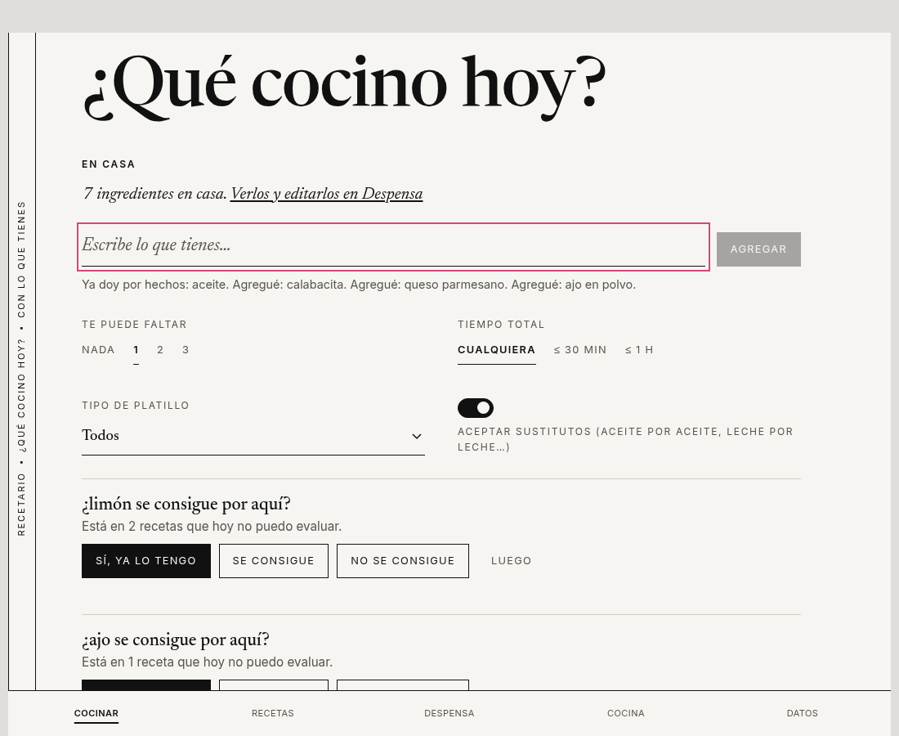
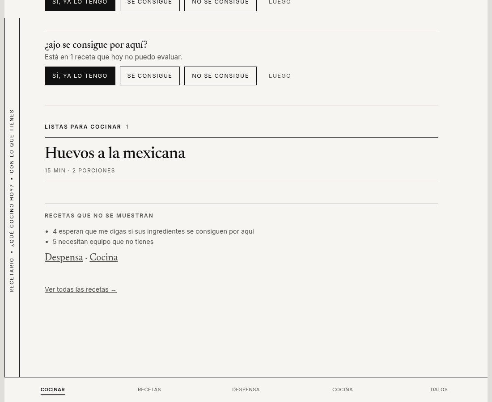
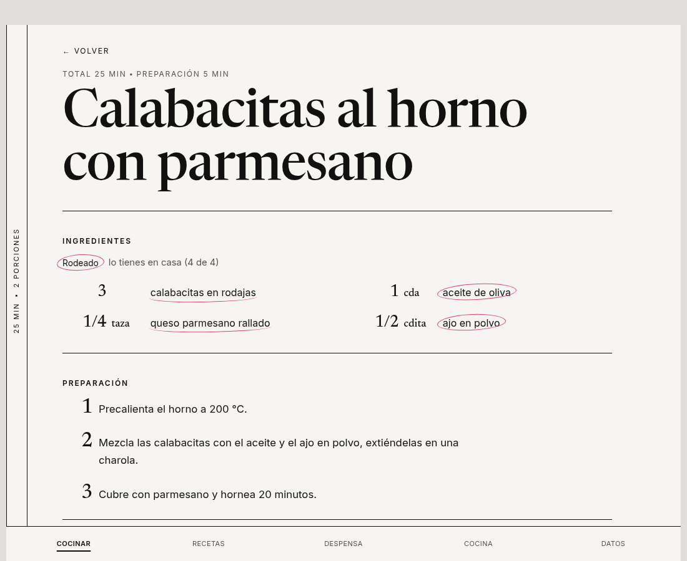
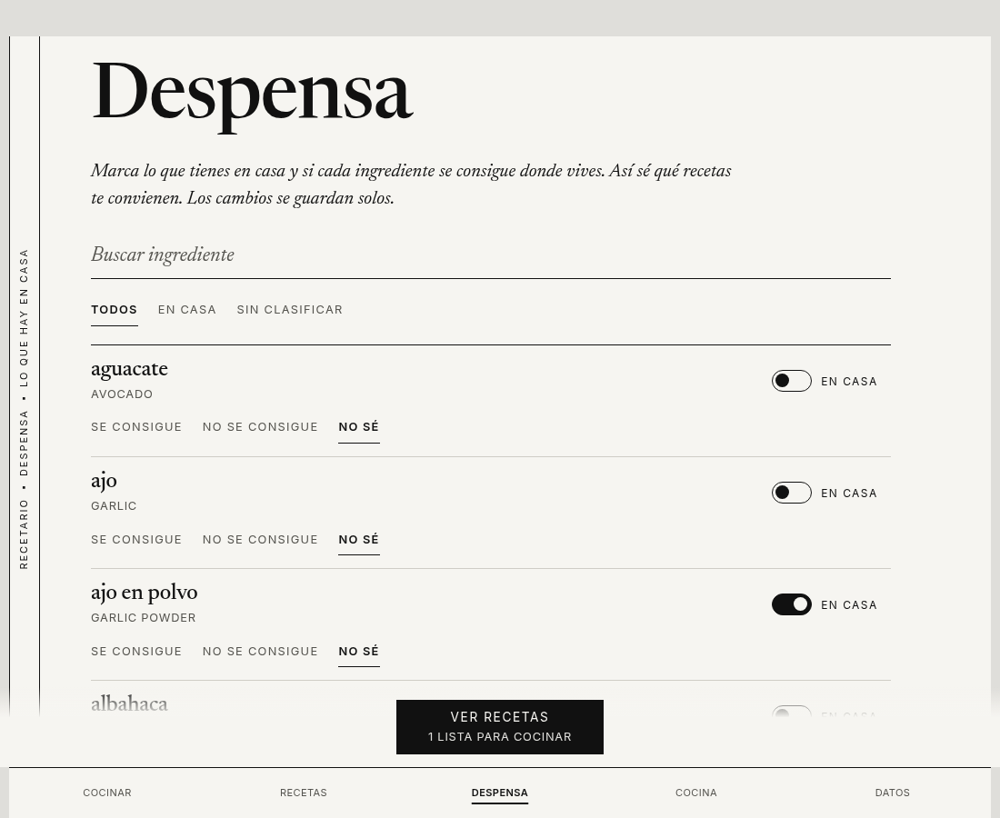

# Recetario

Recetario answers one question: *what can I cook with what I have at home?*

It has two parts:

- **`ingest`** is a command line tool. It reads cookbooks you own (EPUB or PDF), asks an AI model to pull out each recipe, cleans up the ingredient names, translates the recipes to Mexican Spanish, and writes everything into one SQLite file, `recetario.db`.
- **`app`** is a small web app. You open that database in it, tell it what is in your kitchen, and it lists the recipes you can make now, the ones that are missing one or two things, and what to buy. It works offline and your data stays in your browser. The app itself is in Spanish.

No books or recipes are included in this repository. You bring your own books, and everything made from them stays on your computer, in the git-ignored `local/` folder.

<p>
  
  
</p>
<p>
  
  
</p>

The screenshots use the ten sample recipes that come with the repository.

## What you need

- [`git`](https://git-scm.com/)
- [`uv`](https://docs.astral.sh/uv/) for the Python side. It installs Python 3.14 for you.
- [Node.js](https://nodejs.org/) 24 and [`pnpm`](https://pnpm.io/) for the app.
- An AI model for reading the books. You pick one of these three:

| Provider | What you need | Notes |
|---|---|---|
| `anthropic` | An API key from the [Anthropic Console](https://console.anthropic.com/) | Fast, and you pay per use. There is a hard spending cap. |
| `openrouter` | An API key from [OpenRouter](https://openrouter.ai/) | Lets you try many models. The real cost is read from each reply. |
| `claude-code` | The [Claude Code](https://claude.com/claude-code) command line tool, signed in with your Claude plan | No API key. It is slower and uses your plan's usage limits. |

You don't need any of this to try the app. See "Try the app without any books" below.

## Set it up

```sh
git clone <this repository>
cd recetario

cp .env.example .env                 # then put your key in it (see below)
cp recetario.example.toml recetario.toml
```

**API keys** go in `.env`, which git ignores. Fill in only the one you use:

```
ANTHROPIC_API_KEY=your-key
OPENROUTER_API_KEY=your-key
```

**Settings** go in `recetario.toml`, also ignored by git. Open it and read the comments. The important part is the `[llm]` section, where you choose the provider and the model. Recetario was tested most with Claude Haiku, which gave good results for a small cost.

If you use the `anthropic` provider, uncomment the `[pricing."<model id>"]` section and copy the prices from the provider's price page. Recetario needs them to track the cost and to enforce `max_cost_usd`, the spending cap.

## Ingest your books

Put your `.epub` or `.pdf` files in `local/books/`. Then:

```sh
cd ingest
uv sync
uv run recetario-ingest db init                 # creates local/recetario.db
uv run recetario-ingest ingest --dry-run        # counts recipes and estimates the cost; calls no model
uv run recetario-ingest ingest --one-by-one     # sizes up each book, asks before spending, then ingests it
```

You can also ingest everything in the folder with `uv run recetario-ingest ingest`. It is safe to run again: finished work is cached, so a run that stops halfway picks up where it left off.

A book of about 70 recipes took roughly five minutes and about 17 cents with Haiku through the API. A book of about 285 recipes cost about 50 cents.

### Choose the model for each run

You can give each run its own provider and model, with a named profile from `recetario.toml` or with flags:

```sh
uv run recetario-ingest next --profile haiku-api
uv run recetario-ingest next --profile haiku-plan --workers 2
uv run recetario-ingest next --provider openrouter --model deepseek/deepseek-chat
```

`--workers` is how many model calls run at the same time. A higher number is faster. If your provider answers with "too many requests", lower it.

### Useful commands

| Command | What it does |
|---|---|
| `queue` / `next` | Work through the books listed in `local/queue.txt`, one at a time |
| `costs [--by-stage]` | Show what each book cost, over all its runs |
| `review` | Go through the ingredient names the tool was unsure about |
| `review --accept-above 0.8 --apply` | Accept the confident ones in bulk, after a backup |
| `load` | Write the finished books into the database again, after a review. Calls no model |
| `classify` | Give every recipe a course: main dish, side, dessert and so on |
| `vocab merge A B` | Fold one ingredient into another that means the same |

After you add books or review names, `scripts/sync-db.sh` backs up the database, brings it up to date and prints where things stand.

## Run the app

```sh
cd app
pnpm install
pnpm dev
```

Open the address it prints. On the first screen press **Cargar la base local**, or open the **Datos** tab and choose your `local/recetario.db` file. The database is loaded into your browser and never uploaded anywhere.

To build the app as a static site, run `pnpm build`. The result is in `app/dist`.

### Try the app without any books

This makes a database with ten hand-written sample recipes. It needs no key and calls no model:

```sh
cd ingest
uv sync
uv run recetario-ingest db init --fixtures
cd ../app
pnpm install
pnpm dev
```

## Optional: asking in plain words

The app can have a question box where you type something like "algo rápido con huevo y jitomate". The question goes to a small Netlify function (`app/netlify/functions/ask.mts`) that asks Claude to turn it into filters. The box only appears if you turn this on, and the function is off by default. See `app/.env.example` for the settings. Your Anthropic key is set in the Netlify environment, never in the app.

## Run the tests

```sh
cd ingest && uv run pytest
cd app && pnpm test
```

## How the repository is laid out

| Folder | What is in it |
|---|---|
| `ingest/` | The Python tool that turns books into a database |
| `app/` | The web app |
| `schema/` | The database schema (numbered migrations), the starter vocabulary and the sample recipes |
| `evals/` | Small test sets for checking the model's work |
| `scripts/` | Helper scripts |
| `local/` | Yours: books, database, cached model answers. Git ignores it |

## A note on books

Use books you own, for yourself. The recipes the tool makes are copies of someone else's work. Keep them private, and don't publish the database.

## License

MIT. See `LICENSE`.
